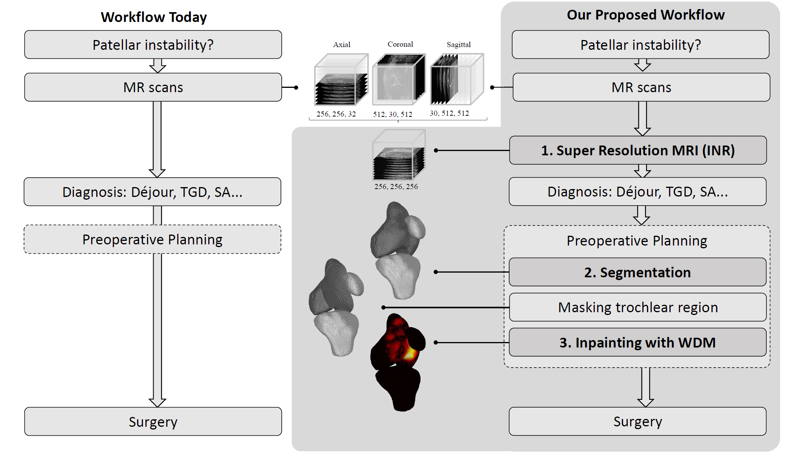

# Towards MR-based Trochleoplasty Planning

[](https://opensource.org/license/MIT)
[](https://wehrlimi.github.io/sr-3d-planning/)
[](https://arxiv.org/abs/2508.06076)


This is the repository for the Paper "[Towards MR-based Trochleoplasty Planning](https://arxiv.org/abs/2508.06076)" by Wehrli et al., accepted at the MICCAI Workshop 2025 [COLAS](https://sites.google.com/view/miccai-2025-colas/home). Check out our [Project Page](https://wehrlimi.github.io/sr-3d-planning/).

You can test our proposed workflow yourself with the publicly available dataset from **[fastMRI](https://fastmri.org/)**.

If you have any questions, feel free to contact me: michaeljan.wehrli@unibas.ch

Tested with CUDA Version: 12.6 and 12.8.
NOTE: For the last step you will need at least an NVIDIA A100-SXM4-40GB.

# Paper Abstract

To treat Trochlear Dysplasia (TD), current approaches rely mainly on low-resolution clinical Magnetic Resonance (MR) scans
and surgical intuition. The surgeries are planned based on surgeons experience, have limited adoption of minimally
invasive techniques, and lead to inconsistent outcomes. We propose a pipeline that generates superresolved,
patient-specific 3D pseudo-healthy target morphologies from conventional clinical MR scans. First (step 1), we compute an
isotropic superresolved MR volume using an Implicit Neural Representation (INR). Next (step 2), we segment femur, tibia, patella,
and fibula with a multi-label custom-trained network. Finally (step 3), we train a Wavelet Diffusion Model (WDM) to generate
pseudo-healthy target morphologies of the trochlear region.




# Overview

```plain
SR-3D-pln/
├── data/...                          
├── env/...                      
├── src/                                            
│   ├── step0_preprocess.py
│   ├── step1_INR/                                  
│   │   ├── ...
│   │   └── main.py
│   ├── step2_seg/                         
│   │   └──> Use Monailabel (or Totalsegmentator)
│   └── step3_cWDM/
│       ├── ... 
│       ├── step3_preprocess.py                     
│       └── run.sh                                  
├── setup.sh
└── README.md
```

# How to Run This Repository

Follow the steps below to set up and run this repository.

Clone the repository to your machine.

```bash
git clone https://dbe-gitlab.dbe.unibas.ch/michaeljan.wehrli/sr-3d-pln.git
```
We recommend using micromamba to manage environments, especially since this repository involves multiple projects that depend on different PyTorch and Python versions.
We assume you are on a Linux machine (if you are on Windows, use [wsl](https://learn.microsoft.com/en-us/windows/wsl/install)).
Install Micromamba (if not already installed). You can install micromamba with:
```bash
curl -L https://micro.mamba.pm/install.sh | bash
```
```bash
source ~/.bashrc  # or appropriate shell config
```
```bash
micromamba activate
```

The setup script creates separate environments for different parts of the project. To set them up:

```bash
cd sr-3d-pln
bash -i setup.sh
```

# Step 0: Preprocessing Data

Get the data here: [fastMRI](https://fastmri.org/). The folder we are interested in is called knee_DICOMS_batch2.tar.xz.
Place the extracted folder in the folder data (it's called "knee_mri_clinical_seq_batch2" after extraction).

Use the script: step0_preprocess.py

To convert DICOM to Nifti and store metadata:
- We only convert volumes matching the ACCEPTED_DESCRIPTIONS
- We only convert complete one's (3 views)
- We track if there is a failure in the conversion process
- Each volume get's a unique ID
- We store all metadata info in an Excel table

```bash
cd src/
micromamba activate env_step0_preprocess
python step0_preprocess.py
```

# Step 1: Implicit Neural Representation (INR)

To facilitate the Segmentation task that follows in Step 2, we only take descriptions of the sequence (Proton-Density).
Details can be found in the "ACCEPTED_DESCRIPTIONS" dict in step0_preprocess.py. To create SR images out of these, run:
 
```bash
micromamba deactivate
cd step1_INR/
micromamba activate env_step1_INR
python main.py
```
This results in subjects with a Super-Resolution MRI, it will be stored in data/01_INR.


# Step 2: Segmentation

https://docs.monai.io/projects/label/en/latest/quickstart.html

We use the radiology app with the pretrained SegResNet.
Unfortunately, we are not allowed to share our segmentations with the community, due to the fastmri regulations (5b, here: https://fastmri.med.nyu.edu/). 

However, if you trained your own segmentation network, the command to run inference (with the above described monailabel framework) for a complete set of .nii.gz files would be:

```bash
# NOTE: This 'main.py' refers to your Monai Label app's CLI, not a file in this repo.
python main.py --studies "data/01_INR/fastMRI_INR" --test batch_infer --model segmentation
```
A workaround would be to use publicly available  [Totalsegmentator](https://github.com/wasserth/TotalSegmentator).
Use the modules "appendicular_bones_mr" to segment tibia, fibula and patella and the "total_mr" module for the femur. You need to activate the licence for the "appendicular_bones_mr" module.

```bash
micromamba deactivate
cd ../step2_seg
micromamba activate env_step2_seg
bash Totalsegmentator.sh
```
```bash
micromamba deactivate
micromamba activate env_step0_preprocess
python fuse_TotSeg.py
```

# Step3: Conditional Wavelet Diffusion Model

Similar as in Wehrli [1], Durrer [5] and Friedrich [6] we use the Wavelet Diffusion Model with a concatenated condition. But we operate in the already segmented space voxel space which facilitates the task a lot.

To prepare the segmentations for the inpainting task (Masking trochlear region):
```bash
# From repo root
cd ../step3_cWDM
micromamba deactivate
micromamba activate env_step3_prepro
python step3_preprocess.py
```

## Training
Adjust the "general settings", the COMMON & TRAIN flags in the run.sh file to reflect your data and setup.
To start the training, run:

```bash
# From repo root
micromamba deactivate
micromamba activate env_step3_cWDM
# Training
bash ./run.sh
```
## Inference
 Edit SAMPLE line in run.sh: set GPU, --data_dir, --model_path, --output_dir. You can use this trained model now to generate sub-millimeter resolved 3D shapes.
```bash
# Sampling
bash ./run.sh
```

Use Marching Cubes to convert it to a Mesh and visualize it for example with [vedo](https://github.com/marcomusy/vedo/tree/master).

If you find our work useful, please consider to star this repository and cite our paper:

<pre>
@article{wehrli2025towards,
      title={Towards MR-Based Trochleoplasty Planning},
      author={Wehrli, Michael and Durrer, Alicia and Friedrich, Paul and Hadramy, Sidaty El and Li, Edwin and Brahaj, Luana and Hasler, Carol C and Cattin, Philippe C},
      journal={arXiv preprint arXiv:2508.06076},
      year={2025}
      }
</pre>

## References

[1] [Wehrli](https://github.com/wehrlimi/Generate-Pseudo-Healthy-Knee-MRI), Michael, et al. "Generating 3D pseudo-healthy knee MR images to support trochleoplasty planning." International Journal of Computer Assisted Radiology and Surgery (2025): 1-8.

[2] [McGinnis](https://github.com/jqmcginnis/multi_contrast_inr/), Julian, et al. "Single-subject multi-contrast MRI super-resolution via implicit neural representations." International Conference on Medical Image Computing and Computer-Assisted Intervention. Cham: Springer Nature Switzerland, 2023.

[3] [Diaz-Pinto](https://github.com/Project-MONAI/MONAILabel), Andres, et al. "Monai label: A framework for ai-assisted interactive labeling of 3d medical images." Medical Image Analysis 95 (2024): 103207.

[4] [Akinci D’Antonoli](https://github.com/wasserth/TotalSegmentator), Tugba, et al. "Totalsegmentator mri: Robust sequence-independent segmentation of multiple anatomic structures in mri." Radiology 314.2 (2025): e241613.

[5] [Durrer](https://github.com/AliciaDurrer/DM_Inpainting), Alicia, Philippe C. Cattin, and Julia Wolleb. "Denoising diffusion models for inpainting of healthy brain tissue." International Challenge on Cross-Modality Domain Adaptation for Medical Image Segmentation. Cham: Springer Nature Switzerland, 2023. 35-45.

[6] [Friedrich](https://github.com/pfriedri/wdm-3d), Paul, et al. "Wdm: 3d wavelet diffusion models for high-resolution medical image synthesis." MICCAI workshop on deep generative models. Cham: Springer Nature Switzerland, 2024.